<div align="center">


# KPlayer for Samsung Smart TV

</div>

KPlayer is a lightweight web app for Samsung Tizen TVs that turns your playlist provider into a clean, fast, 10-foot UI. It streams live TV and VOD from your own [M3U](https://en.wikipedia.org/wiki/M3U) links, [Xtream Codes](https://xtreamcodes.org) accounts or shared JSON lists, with a full-screen guide, categories, favorites, search and a TV-first remote-control flow.

No account, no telemetry, no third-party service in between: the app talks straight to your provider with plain HTTP from inside the TV.

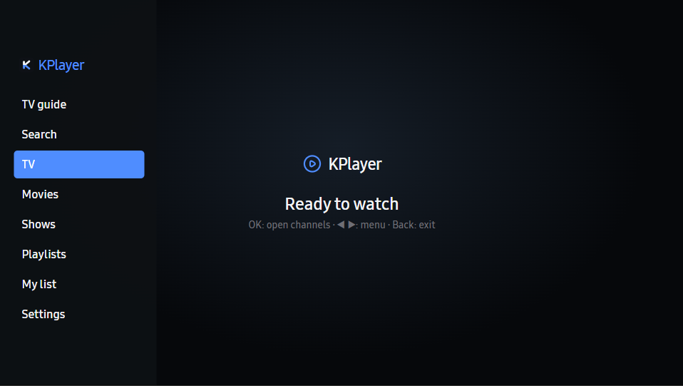

## Feature overview

| | |
|---|---|
| **Live TV** | Channel list with groups, favorites, recents, logo grid and zapping that feels instant |
| **TV guide** | Full-width EPG grid with now/next line, group rail at the bottom and per-row programme cells |
| **Movies and Shows** | Xtream VOD browsing with category rail, poster grid, detail pages with resume progress |
| **My list** | Bookmark movies and series and pick them up again from the icon rail |
| **Search** | One box that searches channels, movies and series at unbeaten speed using a local index |
| **Playlists** | Multiple sources side by side, one tap to switch, JSON catalogs supported out of the box |
| **Parental controls** | Six digit PIN, per-group locking, hidden PIN screen |
| **Settings** | Buffer size, decoder, seek step, EPG retention, accent color, backup and restore |

## Screens

### Home and channels

The app boots straight into the player with your last channel (configurable), and the main menu is one click away with the left arrow. While watching, OK opens the channel list in a side panel with a live preview of the focused channel.

| Menu over the player | Channel list with preview |
|:---:|:---:|
|  | 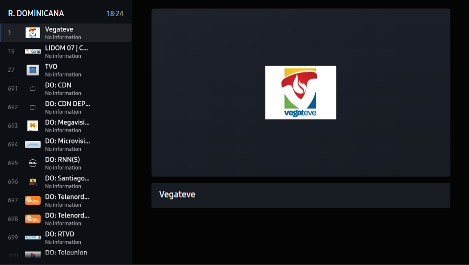 |

While a stream is playing the info bar shows what you are watching, programme progress and quick cards for the guide, history and nearby channels.

| Info bar | Ready to watch |
|:---:|:---:|
| 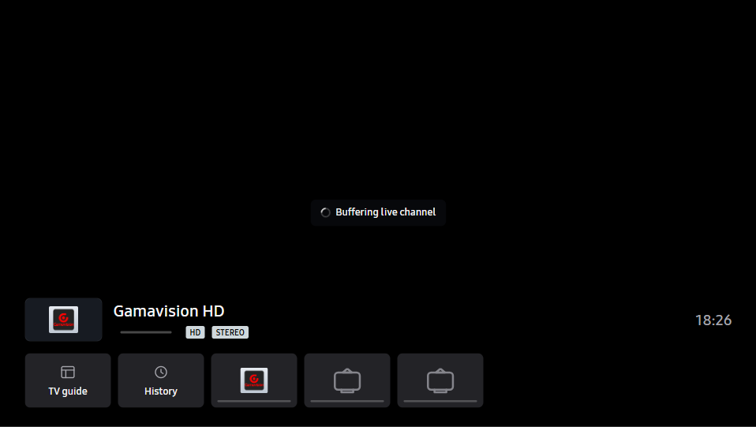 | 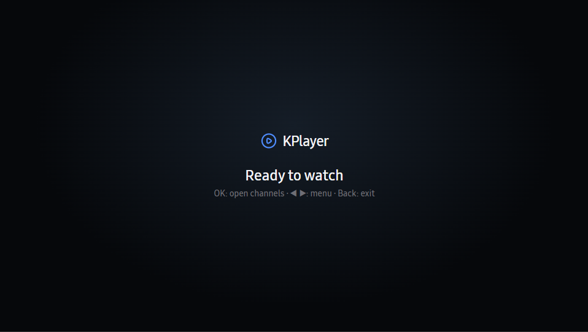 |

### TV guide

The guide is a full-width EPG grid. Groups are listed in a panel at the bottom, you can jump with page keys, and the now line sits at the current time. Rows fill in as programme data arrives; groups you have already visited come from cache.

| Guide | Detail page |
|:---:|:---:|
| 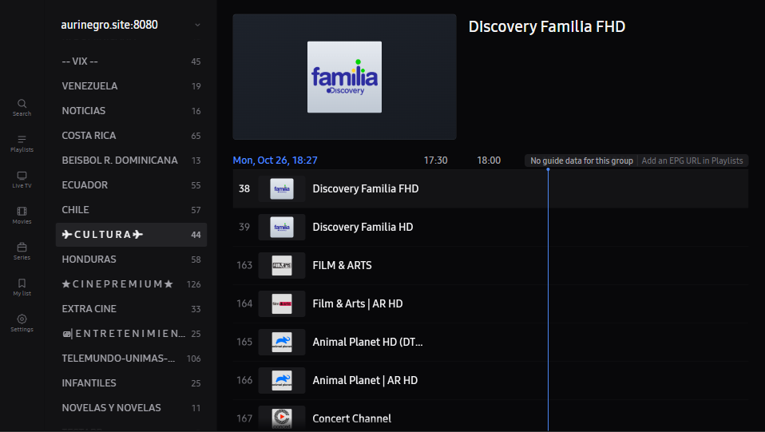 | 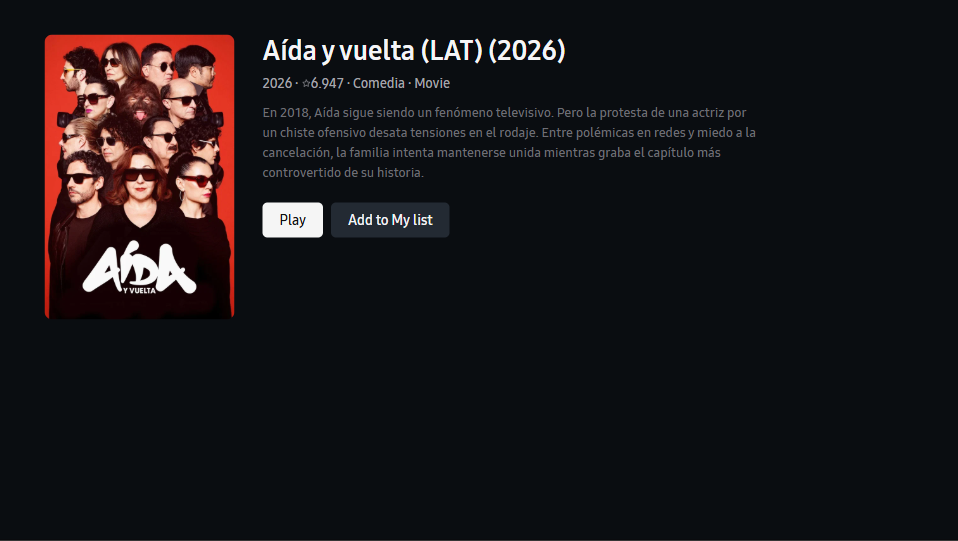 |

Note: EPG depends on your provider. Providers that ship a guide URL (XMLTV) or expose Xtream short EPG get a filled grid, others show the empty state you see above.

### Movies and Shows

Xtream VOD is organized in categories with a poster grid. Focus is always pinned near the middle so the grid glides under the selection, exactly like on premium TV apps. Detail pages show the year, rating, plot and resume position.

| Poster grid | Search |
|:---:|:---:|
| 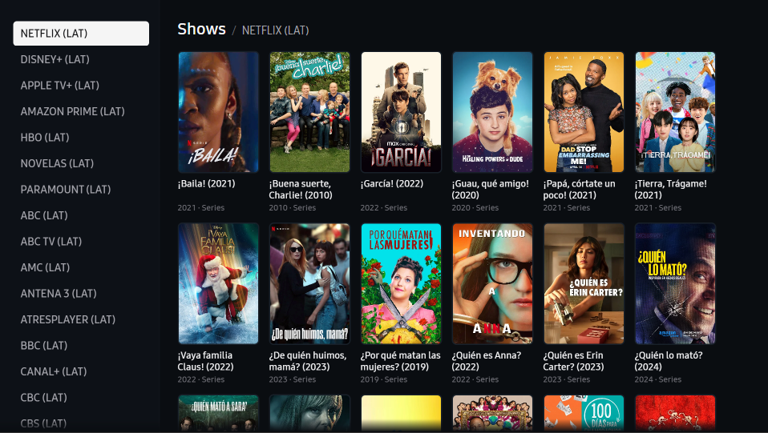 | 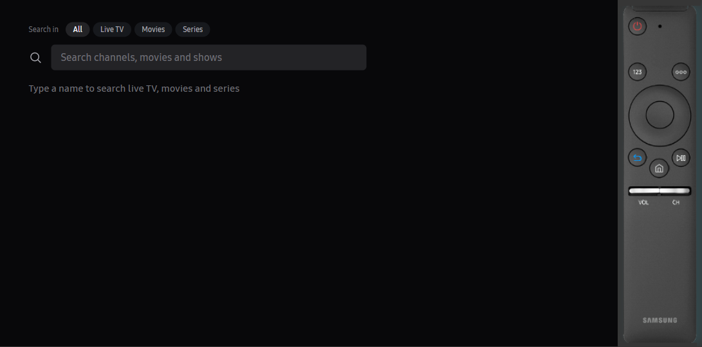 |

### Playlists

Add as many sources as you want. The app keeps them in a list, tracks when each one was last updated, and lets you switch or remove them from a per-row menu.

| Playlist list | Add source |
|:---:|:---:|
| 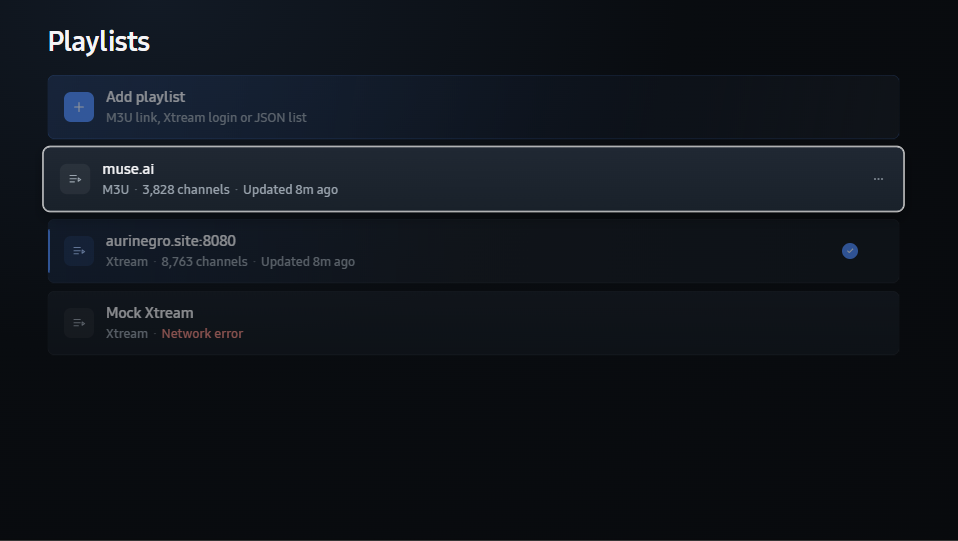 | 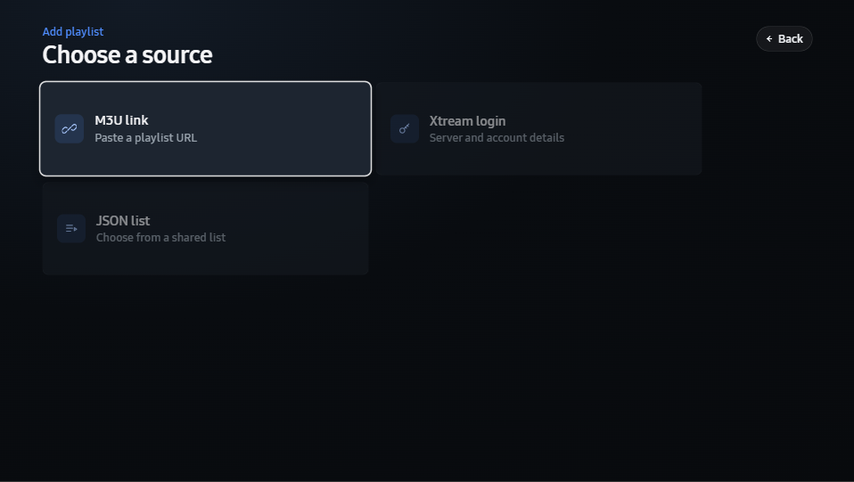 |

Three source types are supported today:

- **M3U link**: paste a playlist URL, EPG link is optional.
- **Xtream login**: server URL, username and password. Live categories, VOD and series are all loaded.
- **JSON list**: point to a JSON file with several pre-created playlist entries in it, choose which ones to install.

### Settings

Tune playback (buffer size, hardware or software decode, seek step), EPG retention, accent color and parental controls, with backup and restore to a file so you can clone the setup between TVs.

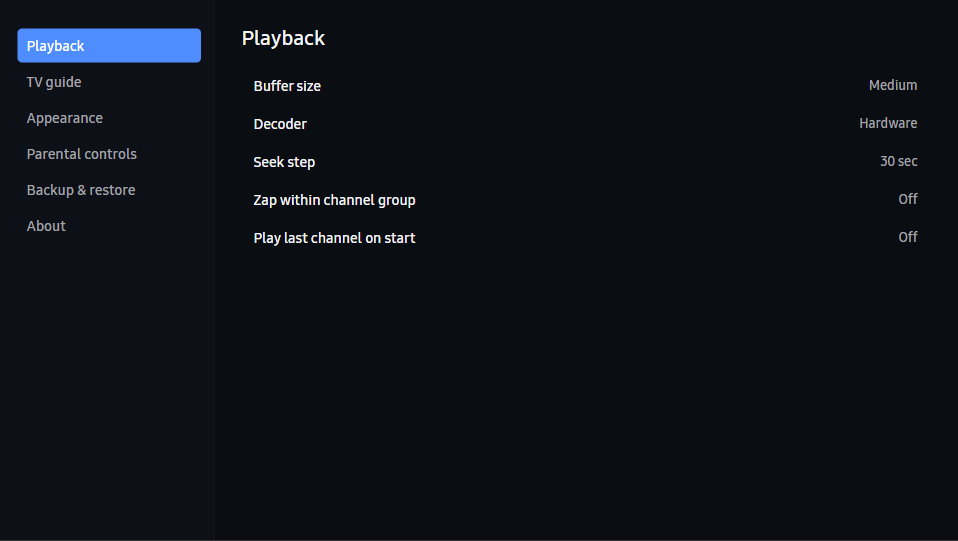

## Install on your TV

### Option 1: use a prebuilt package

Grab the latest signed `KPlayer-<version>.wgt` from the [Releases](../../releases) page, then install it over the network:

1. Enable **Developer mode** on the TV: Apps, press 12345 on the remote, enter the developer IP of your PC and confirm.
2. Start **Tizen Studio Device Manager** or `sdb` from the Samsung toolchain.
3. Connect to the TV and push the package:

```bash
sdb connect <tv-ip>
sdb install KPlayer-<version>.wgt
```

4. The app appears in your app list with the blue KPlayer icon. Version history is shown under Settings, About.

### Option 2: build it yourself

Requirements: [Tizen Studio](https://developer.samsung.com/tv/develop/tools/tizen-studio) (Web CLI 9.0 or newer works fine, the project targets `tv-samsung-10.0`), plus a Samsung signing certificate created in Certificate Manager.

```bash
# from the project root
tizen build-web -a .
tizen package -t wgt -o Debug -- .
```

If you use the newer `tz` command line that ships with the AngryJuicer/ibusozel toolchains, the equivalent is:

```powershell
tz build .
tz pack .
```

The output is `Debug/tvapp.wgt`, install it with `sdb install` as above, or run it in the bundled Tizen TV Web Simulator.

### Run in the simulator without a TV

```powershell
 tz run --file=. --simulator
```

The simulator maps your keyboard to remote keys and mocks the Samsung input, AVPlay and storage APIs, so everything except real video decoding can be explored on a PC.

## Remote control map

| Key | Action |
|---|---|
| **OK** | Open channel list while watching, play inside views |
| **Left / Right** | Main menu and highlight movement |
| **Up / Down** | Highlight movement everywhere, EPG group switch in the guide |
| **Back** | One step back per level, first press at the root asks before exiting |
| **Ch Up / Down** | Zapping between channels, even over the guide |
| **1 - 9 digits** | Direct channel number entry while watching |
| **Hold Right / Left** (in VOD) | Continuous seek in 10-60 second steps, configurable |
| **Tools / Menu** | Audio, subtitle and video settings while playing |

## Supported playlist formats

The parser is at `js/parsers.js`. In short:

- Standard `#EXTM3U` with `tvg-id`, `tvg-logo`, `tvg-shift`, `group-title`, catch-up and radio tags survive.
- Xtream Codes endpoints use `player_api.php` for categories, streams, series info, VOD info and `get_short_epg`.
- The JSON list format (used by community link lists) is an array of playlist objects. See `jsonPlaylist` handling in `js/store.js`.
- Huge M3U files are parsed in chunks on a timer so the UI never freezes; the first 50,000 entries are kept to protect low-RAM TVs.

## Architecture at a glance

```
index.html         all views as lightweight HTML, no framework
css/app.css        one stylesheet, CSS custom properties + TV-safe pixel scaling
js/
  core.js          KP.* namespace: utils, icons, logo handling, key routing helpers
  net.js           fetch wrapper with timeouts, retries and size caps for media
  parsers.js       M3U, XMLTV and Xtream URL builders, chunked parsing
  store.js         playlist data model, localStorage persistence, catalog loads
  epg.js           EPG engine: XMLTV bulk loads plus a concurrency-limited queue
  player.js        AVPlay wrapper, stream state machine, retry and recovery
  ui-*.js          one module per view: shell, guide, channels, vod, playlists...
  vod.js           VOD catalog, categories, search index
qa/                headless rigs (puppeteer) that smoke-test critical flows
docs/screens/      the screenshots used by this README
```

Design notes:

- App targets Chromium 63 era engines on Tizen 5 to 8. Everything is ES2017, no transpile step, no runtime dependency, whole bundle stays under half a MB.
- All UI metrics are computed in `designPx` units from a 1920 by 1080 design grid, so the same code fits every Samsung TV resolution class.
- Focus management is hand-rolled per view, giving deterministic remote key behavior without DOM focus quirks on the TV.
- Streaming uses the platform AVPlay interface. Buffering is user-selectable, network failures degrade to retry screens instead of white screens.

## QA

The `qa/` folder holds puppeteer rigs that boot the app headless and assert the critical flows still work:

```bash
npm i puppeteer-core   # any Chromium build on PATH also works, see qa scripts
node qa/vod-back-test.js      # VOD navigation and back stack sanity
node qa/channels-pad-test.js  # channel list middle-pinned scroll behavior
node qa/guide-burst.js        # guide rapid navigation stability
```

They run against a local mock server (`qa/server.js`) that fakes an Xtream provider, so no real subscription is needed for CI style checks.

## Roadmap

- [ ] Add from phone (QR pairing) source for playlists
- [ ] Series episode picker with resume progress per episode
- [ ] Catch-up playback with guide integration for providers that support it
- [ ] More themes and deeper logo fallbacks

## Legal

This app does NOT provide any TV channels or content. You supply your own playlist from a provider you are entitled to use. Do not use it to pirate streams. Samsung, Tizen and all product names are trademarks of their respective owners.
